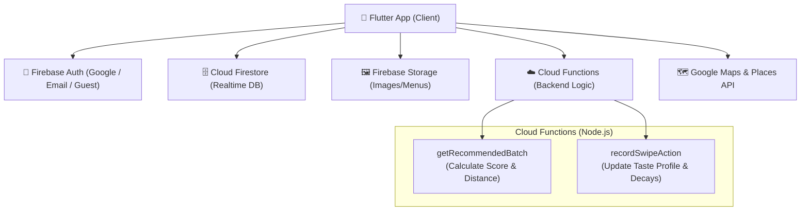

# DISHCOVERY (ดิชคัฟเวอรี)

> **Tinder-style Food & Restaurant Discovery App**  
> แก้ปัญหา _"วันนี้กินอะไรดี?"_ ด้วยการปัดการ์ดค้นหาร้านอาหารใกล้ตัว ขับเคลื่อนด้วยระบบ Recommendation Engine อัจฉริยะ

[](https://flutter.dev)
[](https://dart.dev)
[](https://firebase.google.com)
[](#)

---

## เกี่ยวกับโปรเจกต์ (About The Project)

**DISHCOVERY** เป็นแอปพลิเคชันค้นหาร้านอาหารบนสมาร์ตโฟนที่พัฒนาด้วย **Flutter** และ **Firebase** ออกแบบมาเพื่อเปลี่ยนประสบการณ์การเลือกร้านอาหารให้สนุก รวดเร็ว และตรงใจผู้ใช้มากที่สุด ด้วยอินเทอร์เฟซแบบ **Card Swiping (Tinder-like UI)** พร้อมระบบแนะนำร้านอาหาร (Recommendation Engine 2.0) ที่วิเคราะห์พิกัดระยะทางจริง (GPS), รสนิยมความชอบส่วนบุคคล (Taste Profile), และความนิยมของร้านอาหารแบบ Real-time

---

## ฟีเจอร์หลัก (Key Features)

แอปพลิเคชันแบ่งบทบาทและระบบการทำงานออกเป็น 3 ฝั่ง:

### 1. 👤 สำหรับผู้ใช้งานทั่วไป (Foodie / User)

- **Tinder-like Card Swiping:**
  - 🟢 **Swipe Right (ปัดขวา):** Yum! (ถูกใจ/อยากกิน)
  - 🔴 **Swipe Left (ปัดซ้าย):** Pass (ข้าม/ยังไม่โดน)
  - 🔵 **Swipe Up (ปัดขึ้น):** Favorite (บันทึกเป็นร้านโปรดทันที)
- **Recommendation Engine 2.0:** ระบบแนะนำร้านอาหารอัจฉริยะ คำนวณจาก:
  - พิกัด GPS แบบ Real-time ตามรัศมีที่กำหนด
  - Taste Profile ความชอบส่วนบุคคล (หมวดหมู่อาหาร, ช่วงราคา, ช่วงเวลาที่ชอบทาน)
  - Trending Score และคะแนนความนิยมของร้าน
- **Restaurant Details & Menus:** ดูรูปถ่ายบรรยากาศร้าน, ข้อมูลติดต่อ, เวลาเปิด-ปิด, และรายการเมนูอาหารพร้อมราคา
- **Interactive Map & Navigation:** ปักหมุดดูตำแหน่งร้านและนำทางผ่าน Google Maps
- **Reviews & Ratings:** อ่านรีวิว ให้คะแนนดาว และเขียนรีวิวแนะนำร้านอาหาร
- **User Dashboard & Preferences:**
  - ดูสถิติการปัด (Total Swipes, Yums, Passes)
  - ตรวจสอบประวัติการปัดย้อนหลัง (History) และคลังร้านโปรด (Favorites)
  - ปรับแต่ง Food Preferences และตัวกรองระยะทาง/ราคา
- **Authentication:** รองรับเข้าสู่ระบบด้วย Email/Password, Google Sign-In และ Guest Login

### 2. 🏪 สำหรับเจ้าของร้านอาหาร (Restaurant Owner / Business)

- **Business Dashboard:** ตรวจสอบสถิติ Engagement ของร้าน (ยอด Yum, Pass, Favorite และยอดเข้าชม)
- **Restaurant Management:** แก้ไขข้อมูลร้าน, รายละเอียด, คำอธิบาย, และปักหมุดตำแหน่งร้านผ่าน Map Picker
- **Manage Operating Hours:** กำหนดเวลาเปิด-ปิดร้านในแต่ละวัน
- **Menu Management:** จัดการรายการอาหาร เพิ่ม/ลบ/แก้ไขเมนู แยกตามหมวดหมู่ พร้อมอัปโหลดรูปภาพ
- **Restaurant Registration:** ยื่นคำขอเพิ่มร้านอาหารเข้าสู่ระบบ พร้อมแนบเอกสารและข้อมูลสำคัญ

### 3. 🛡️ สำหรับผู้ดูแลระบบ (Admin)

- **Admin Dashboard:** ภาพรวมสถิติและสถานะร้านอาหารในระบบ
- **Restaurant Approval:** ตรวจสอบและอนุมัติร้านอาหารที่ยื่นขอเปิดระบบ
- **Content Moderation:** ระบบตรวจสอบรายงาน (Reports) จัดการรีวิวหรือร้านอาหารที่ไม่เหมาะสม

---

## System Architecture



### Recommendation & Swipe Flow

1. **คิวการปัด (Queue Buffer):** ฝั่ง Client จะโหลดชุดร้านอาหารมาเก็บไว้ใน `_swipableCache` ทีละ 10 ร้าน ผ่าน Cloud Function `getRecommendedBatch`
2. **การตอบสนองทันที:** เมื่อผู้ใช้ปัดการ์ด UI จะขยับอย่างลื่นไหลด้วย `flutter_card_swiper` พร้อมยิง action ขึ้น Cloud Function แบบ Background
3. **การปรับคะแนน Taste Profile:**
   - **Yum:** +2 คะแนนในหมวดหมู่และช่วงราคานั้นๆ
   - **Pass:** -1 คะแนน
   - **Favorite:** +3 คะแนน
4. **Auto Refill:** เมื่อการ์ดในคิวเหลือน้อยกว่า 3 ใบ ระบบจะเรียก Batch ถัดไปมาเติมต่อท้ายอย่างต่อเนื่องโดยไม่กระตุก

---

## 📁 โครงสร้างโปรเจกต์ (Project Structure)

```text
dishcovery_app/
├── android/                 # Android Native Config
├── ios/                     # iOS Native Config
├── assets/                  # Fonts (SukhumvitSet), Icons (SVG), Images
├── functions/               # Firebase Cloud Functions (Node.js)
│   ├── index.js             # Recommendation Engine & Swipe Logic
│   └── package.json
├── lib/
│   ├── main.dart            # จุดเริ่มต้นแอปพลิเคชัน (Entry Point)
│   ├── firebase_options.dart # การตั้งค่า Firebase ตาม Platform
│   ├── constants/           # ค่าคงที่, Color Theme, Navigation Bars
│   ├── models/              # Data Models (Restaurant, User, Review, Report)
│   ├── services/            # Business Logic & Singletons
│   │   ├── restaurant_service.dart # State & Data Cache หลักของแอป
│   │   ├── auth_service.dart       # ระบบ Authentication
│   │   └── places_service.dart     # เชื่อมต่อ Location & Maps
│   ├── screen/              # UI หน้าจอต่างๆ
│   │   ├── swipescreen.dart        # หน้าปัดการ์ดเลือกร้าน (Main)
│   │   ├── restarurant_detail_screen.dart # รายละเอียดร้าน & รีวิว
│   │   ├── user_profile_screen.dart       # โปรไฟล์ผู้ใช้
│   │   ├── history_screen.dart            # ประวัติการปัด
│   │   ├── favorite_screen.dart           # รายการร้านโปรด
│   │   ├── admin/                         # หน้าจอฝั่งผู้ดูแลระบบ
│   │   └── business/                      # หน้าจอฝั่งเจ้าของร้าน
│   └── utils/               # Helper Functions, UI Helpers, Time Utils
├── pubspec.yaml             # รายการ Dependencies และ Assets
└── README.md
```

---

## Tech Stack

| ส่วนประกอบ             | เทคโนโลยี                                                                            |
| ---------------------- | ------------------------------------------------------------------------------------ |
| **Frontend**           | [Flutter](https://flutter.dev) (v3.38+), [Dart](https://dart.dev) (v3.10+)           |
| **State Management**   | [Provider](https://pub.dev/packages/provider) / ChangeNotifier                       |
| **Card Swiper**        | [flutter_card_swiper](https://pub.dev/packages/flutter_card_swiper)                  |
| **Backend & Database** | [Firebase](https://firebase.google.com) (Firestore, Auth, Storage)                   |
| **Cloud Engine**       | [Cloud Functions for Firebase](https://firebase.google.com/docs/functions) (Node.js) |
| **Maps & Location**    | Google Maps Flutter, Geolocator, Geocoding                                           |
| **Typography**         | Sukhumvit Set Custom Fonts                                                           |

---

## Getting Started

### 1. ความต้องการเบื้องต้น (Prerequisites)

- [Flutter SDK](https://flutter.dev/docs/get-started/install) (เวอร์ชัน 3.38 ขึ้นไป)
- [Dart SDK](https://dart.dev/get-dart)
- [Node.js](https://nodejs.org/) (สำหรับรันหรือ Deploy Cloud Functions)
- [Firebase CLI](https://firebase.google.com/docs/cli)
- Google Maps API Key

### 2. โคลน Repository

```bash
git clone https://github.com/paka04sep/dishcovery_app.git
cd dishcovery_app
```

### 3. ตั้งค่า Environment Variables (.env)

สร้างไฟล์ `.env` ที่ Root Directory ของโปรเจกต์:

```env
MAPS_API_KEY=YOUR_GOOGLE_MAPS_API_KEY
```

### 4. ติดตั้ง Dependencies

```bash
flutter pub get
```

### 5. ตั้งค่า Firebase

ตรวจสอบและใส่ไฟล์การตั้งค่า Firebase:

- Android: `android/app/google-services.json`
- iOS: `ios/Runner/GoogleService-Info.plist`

หรือใช้ FlutterFire CLI เพื่อเชื่อมโยงโปรเจกต์:

```bash
flutterfire configure
```

### 6. การ Deploy Cloud Functions (หากมีการปรับปรุงระบบแนะนำ)

```bash
cd functions
npm install
firebase deploy --only functions
cd ..
```

### 7. รันแอปพลิเคชัน

```bash
# ตรวจสอบอุปกรณ์ที่เชื่อมต่อ
flutter devices

# รันแอป
flutter run
```

---

## Contributing

1. Fork โปรเจกต์นี้
2. สร้าง Feature Branch (`git checkout -b feature/AmazingFeature`)
3. Commit การเปลี่ยนแปลง (`git commit -m 'feat: Add some AmazingFeature'`)
4. Push ไปยัง Branch (`git push origin feature/AmazingFeature`)
5. เปิด Pull Request

---

## 📄 License

This project is for educational and portfolio demonstration purposes. All rights reserved.
